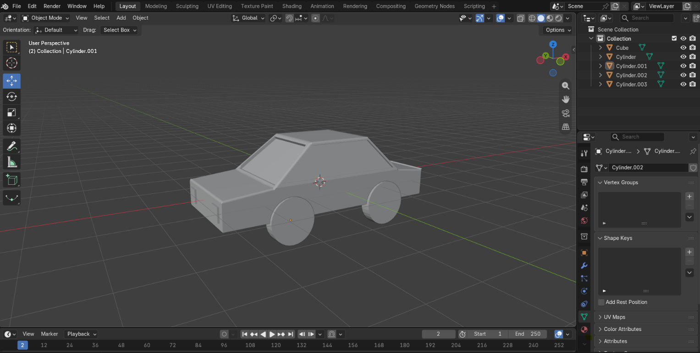
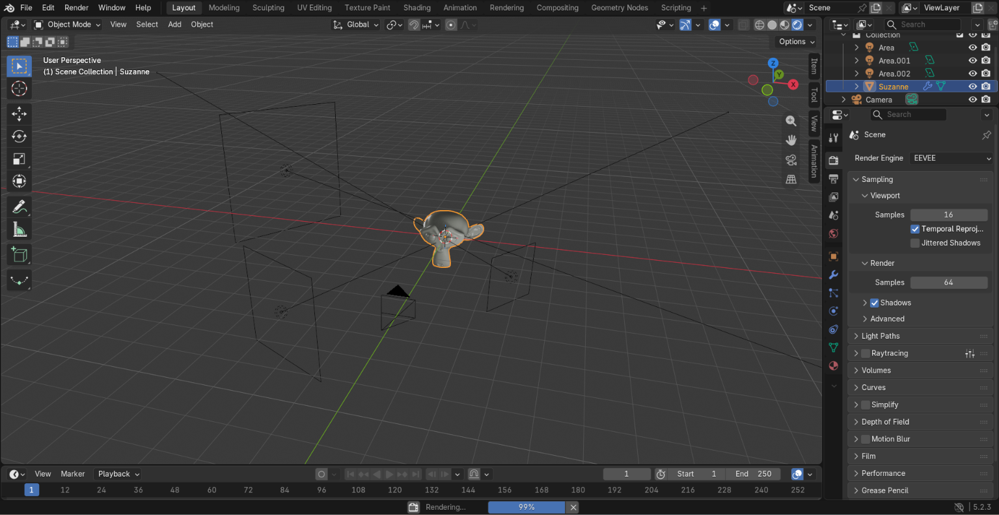
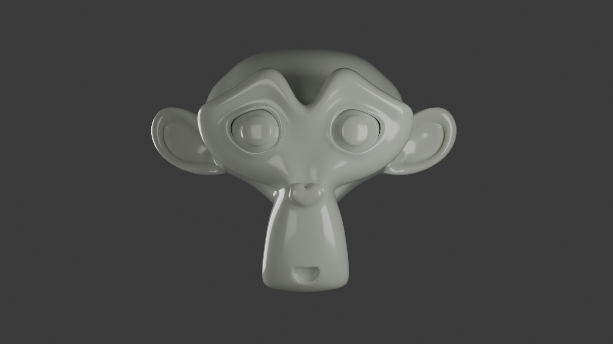
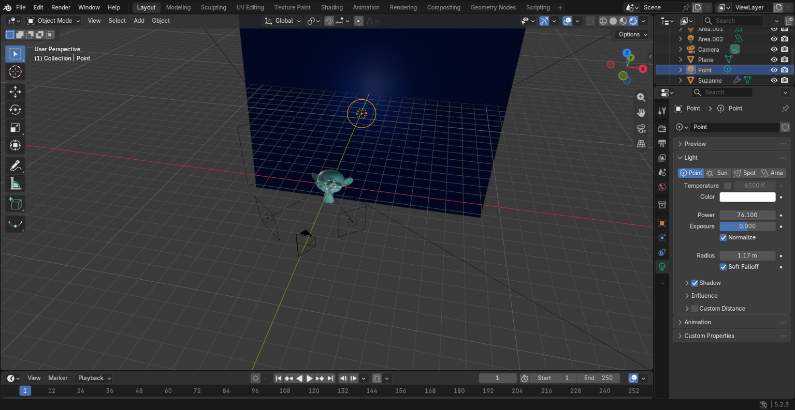
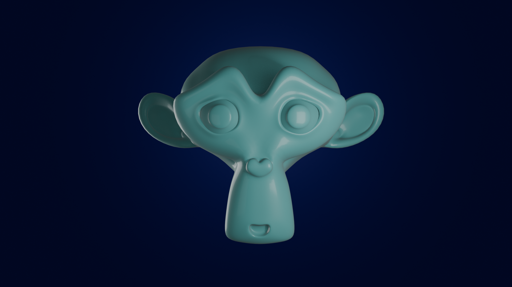
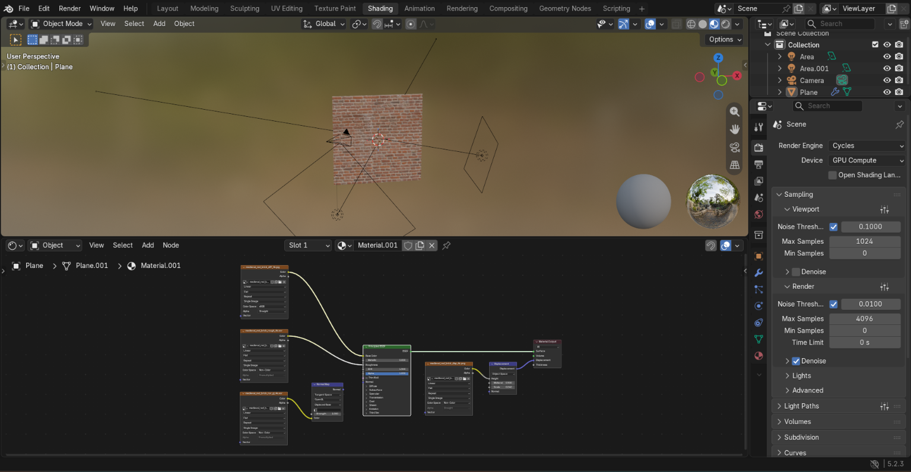
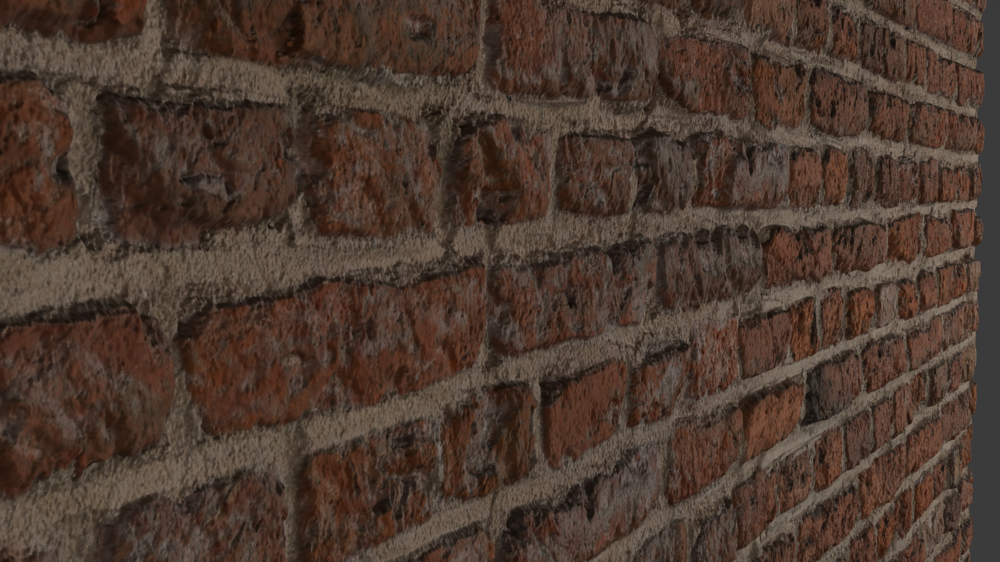
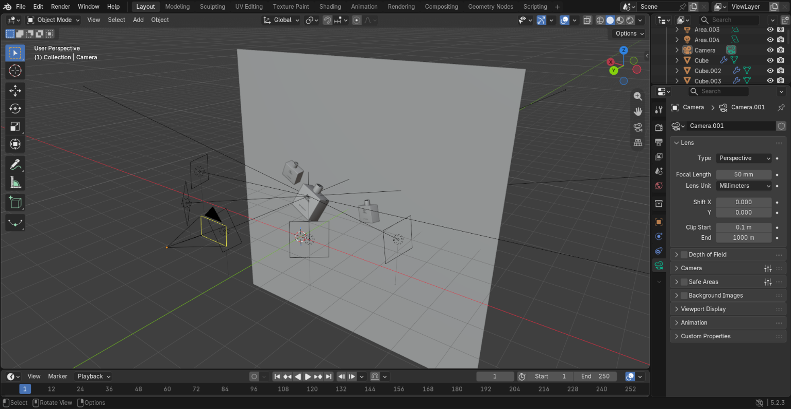
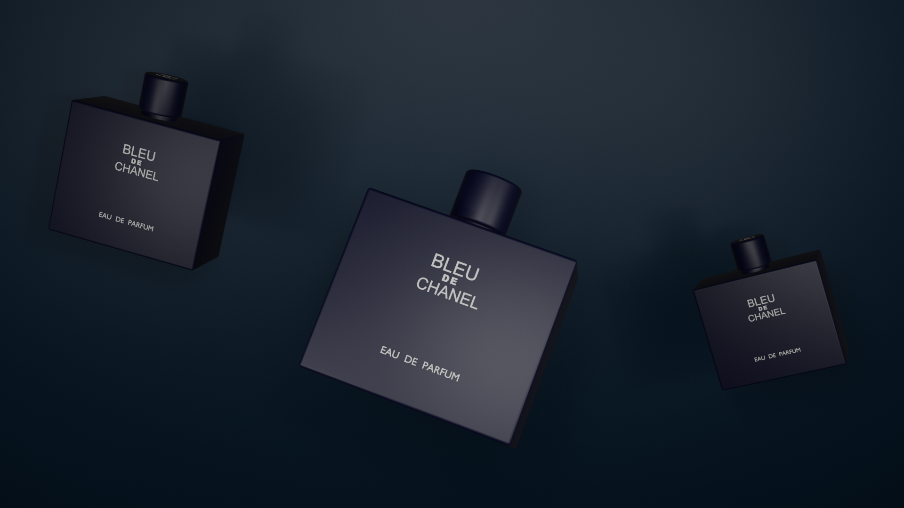

## 🎨 Why I'm Learning Blender

I'm learning Blender just for fun and enjoyment! 

I love exploring 3D modeling, experimenting with different ideas, and creating random things.

This repository is my little collection of Blender projects. I'll keep adding whatever I create, learn, or experiment with along the way.

No pressure, no perfection — just creativity and fun! 🚀

---

## 🚗 Project 01 – My First Car

My first 3D modeling project in Blender!

This project marks the beginning of my journey into 3D modeling. I created my first car using Blender and explored basic modeling, shapes, materials, and design.

### 🖼️ Project Preview

### 🛠️ Tools Used
- Blender

---

### 🗓️ Day 02 – Camera, Lighting & Materials

Today I explored the basics of making 3D objects look better in Blender.

**✨ What I Learned**

- 📷 **Camera:** Learned how to position and use the camera to capture an image of my 3D object.
- 💡 **Three-Point Lighting:** Explored the three basic lights:
  - Key Light
  - Fill Light
  - Back Light
- 🎨 **Materials:** Learned the basics of applying materials and changing the appearance of objects.
- 🖼️ **Rendering:** Explored how camera positioning, lighting, and materials work together to create a final render.

### 🖼️ Practice & Experiments

Here are some screenshots and renders from today's learning.

  
  

### 🗓️ Day 03 – Backgrounds & Scene Lighting

Today I learned about background basics in Blender and experimented with creating a render using a background and lighting.

**✨ What I Learned**

**🌄 Background Basics:** Learned how to add and set up a background for a 3D scene.

**💡 Lighting:** Practiced using lights to illuminate both the object and its surroundings.

**🎨 Scene Setup:** Explored how backgrounds and lighting work together to create an interesting scene.

**🖼️ Rendering:** Created my first render with a background and lighting setup.

**🖼️ Practice & Experiments**

Here are some screenshots and renders from today's learning.

  
  

### 🗓️ Day 04 – Understanding Textures (Brick Texture)

Today I learned about textures in Blender and how they help make 3D objects and renders look more realistic.

**✨ What I Learned**

**🧱 Textures:** Understood what textures and how they add surface details to 3D objects.

**🎨 Brick Texture:** Explored the Brick Texture in Blender and learned how to use it.

**🔍 Realism:** Learned how textures can make simple materials look more detailed and realistic.

**🖼️ Rendering:** Created a render using a brick texture and experimented with its appearance.

**🖼️ Practice & Experiments**

Here are some screenshots and renders from today's learning.

  
  

**💭 My Experience**

It was fun learning how lighting and camera angles can completely change the look of a 3D object. I also enjoyed experimenting with different lighting setups.

Still learning, still experimenting, and enjoying Blender! 🚀

---

## 📚 More Projects Coming Soon!

This repository will be updated with more creative Blender projects.

| No. | Project Name | Status |
|---|---|---|
| 01 | My First Car 🚗 | Completed |
| 02 | Lighting Camera Materials basic | Completed |
| 03 | Render with Background | Completed |
| 04 | Textures | Completed |
| 05 | Practice Project | Completed |

---

## 📚 Practice Projects

**Today's Blender project: Bleu de Chanel Perfume Bottle!**

  
  

## 🎯 My Goal

My goal is to improve my 3D modeling, texturing, lighting, and rendering skills by creating new projects and sharing my progress here.

**One project at a time, one step closer to becoming better at 3D art!**

---

⭐ If you like my work, feel free to star this repository!

